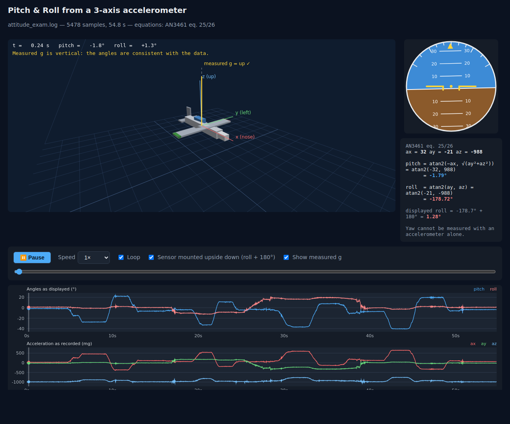

# Pitch and Roll Estimation

Estimates pitch and roll from a 3-axis accelerometer log using the direction of
gravity, saves the result as CSV, and opens an interactive airplane simulation
in your browser. One binary, no servers, no manual steps. Educational project.



## Run

```bash
cmake -S . -B build && cmake --build build
./build/pitch_roll                 # reads attitude_exam.log, writes outputs, opens the browser
./build/pitch_roll my_data.log     # any file in the same format
./build/pitch_roll --an3461        # use the textbook equations (see below)
./build/pitch_roll --no-browser    # just compute and save
ctest --test-dir build             # unit tests
```

Input, one sample per line (timestamp in ms; acceleration in any consistent unit):

```
<timestampMs>; <ax>; <ay>; <az>
```

Outputs, written to the current directory:

| File | Content |
|---|---|
| `output_estimations.log` | `<timestampMs>; <pitchDeg>; <rollDeg>` |
| `output_simulation.html` | self-contained page with the data inlined — opens from disk, works offline |

## How it works

```
attitude_exam.log ──► AccelLogReader ──► AttitudeEstimator ──► EstimationWriter ──► output_estimations.log
                                               │
                                               └──► SimulationPage ──► output_simulation.html ──► Browser
```

| File | Role |
|---|---|
| `src/AttitudeEstimator.*` | **The math.** `estimate({ax, ay, az}) → {pitchDeg, rollDeg}`. No I/O. |
| `src/AccelLogReader.*` | Parses the input log |
| `src/EstimationWriter.*` | Writes the CSV |
| `src/SimulationPage.*` | Fills `web/simulation.html` with the data and writes it |
| `src/Browser.*` | Opens a file with the default browser (`xdg-open` / `open` / `start`) |
| `web/simulation.html` | The simulation: one HTML file, inline JS, Canvas 2D, no libraries. Embedded into the binary by CMake. |
| `main.cpp` | Wires the steps above |
| `tests/` | Estimator cases (one `ctest` entry each) + page generation check |

### The simulation

The browser only *displays* what the C++ computed. The airplane is rotated by
`R = Ry(pitch)·Rx(roll)`; an artificial horizon, the time series, and a formula
panel with the current sample's numbers are shown alongside. Play/pause,
speed, scrubbing, stepping; drag to orbit the camera.

Two checkboxes are worth explaining to students:

- **Sensor mounted upside down** — in `attitude_exam.log`, `az` is always ≈ −1 g,
  so the sensor's Z axis pointed down and roll evaluates to ≈ ±180°. A 180°
  rotation about X turns the readings `(x, y, z)` into `(x, −y, −z)`, which for
  these equations is exactly *roll + 180°* with pitch unchanged. The CSV keeps
  the raw values; the checkbox applies the correction for display.
- **Show measured g** — the accelerometer vector drawn attached to the airplane.
  The accelerometer measures the reaction to gravity, so if (pitch, roll)
  describe the data correctly, the arrow is vertical. With the textbook equations
  it always is; with the Legacy equations it visibly is not.

## The math — and which equations to use

From NXP [AN3461](https://www.nxp.com/docs/en/application-note/AN3461.pdf),
eq. 25/26 (roll about X, then pitch about Y):

$$\phi_{roll} = \operatorname{atan2}(a_y,\ a_z) \qquad
  \theta_{pitch} = \operatorname{atan2}\left(-a_x,\ \sqrt{a_y^2 + a_z^2}\right)$$

Yaw cannot be measured with an accelerometer alone.

| `Convention` | pitch | roll | |
|---|---|---|---|
| `Legacy` (default) | `atan2(-ay, √(ax²+az²))` | `atan2(ay, az)` | What the original program computed. Both angles depend only on `ay`; tilting about Y (`ax`) never changes pitch. Kept so existing outputs stay reproducible. |
| `AN3461_XYZ` (`--an3461`) | `atan2(-ax, √(ay²+az²))` | `atan2(ay, az)` | Textbook. Recommended. |

The original code, its README and AN3461 each stated different formulas. The
refactor keeps the original numbers by default and makes the textbook version
an explicit option, so the difference can be shown rather than hidden.
